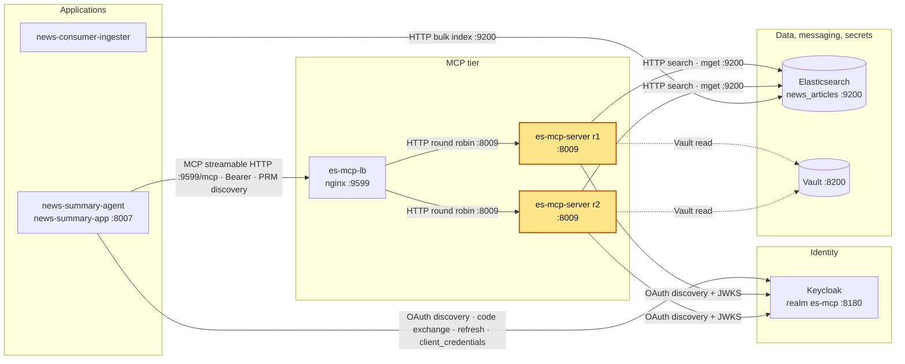

# es-mcp-server

## Purpose

A read-only MCP server over the Elasticsearch `news_articles` index. It is built on
`mcp` 2.3.0 `MCPServer` (`src/server/mcp_server.py`, name `es-mcp-server`, version `1.0`)
and served as a stateless streamable-HTTP Starlette app (`src/main.py` `create_app`, run by
`uvicorn --factory` on port 8009). It is the **only** component that queries Elasticsearch
for the app: news-summary-agent has no Elasticsearch client and reaches articles through these tools.

| Tool | Args | Returns | Errors (client sees) |
|---|---|---|---|
| `article_search` | `user_query: NewsQuery{query: str, categories: list[str], fetch_latest: bool}` | `SearchResult{article_refs: [{article_id, score}]}`, top 5 | ES failure → `Error executing tool article_search` (generic, no details) |
| `category_search` | `categories: list[str]` | `int`, structured as `{"result": n}`: number of docs whose `title` matches any category | ES failure → `Error executing tool category_search: Category search is unavailable` |
| `mget` | `ids: list[str]` (article ids from `article_search`) | `MGetResponse{article_hits: [{article_id, title, source, link, published_at, content}], content_length, truncated}` | none found → `Error executing tool mget: No articles found for the given client ids`; ES failure → `Error executing tool mget` |

How the tools work:
- **`article_search`**: builds the query from `SEARCH_QUERY_TEMPLATE`, a `multi_match` on `title^2`/`content`
  (`minimum_should_match: "2<75%"`). The categories, joined into one string, go into a `should`
  `multi_match` on `title` (boost 1.5). With no categories that clause is dropped. `fetch_latest=true` sets
  `bool.filter` to a `range` on `published_at` with `gte` = an absolute UTC timestamp (now minus 7 days,
  computed in Python by `es_helper.append_latest_query`, not ES date math), replacing any existing filter,
  and sorts newest first, then by `_score`. Only `article_id` is fetched (`_source`).
- **`category_search`**: builds `CATEGORY_QUERY` with one `match: {title: <category>}` per category
  (`minimum_should_match: 1`, `size: 0`) and returns `hits.total.value`. Zero is a valid result and is only logged.
  The `aggs` block (`matched_sources`, terms on `source.keyword`) stays in the YAML but
  `es_helper.category_query()` removes it before sending: the tool only reads `hits.total`, and
  `source.keyword` does not exist under the strict mapping (`source` is itself a `keyword` field).
- **`mget`**: ids that ES reports as `found: false` are skipped. `content` is cut to
  `ARTICLE_CONTENT_MAX_CHARS` (1000) when `TRUNCATE` is true.
- **Annotations**: every tool is `read_only_hint=True`, `destructive_hint=False`, `idempotent_hint=True`, `open_world_hint=False`.
- **Error contract**: expected failures raise `ToolError` with fixed text. Any other exception is
  wrapped by mcp, and the client sees only `Error executing tool <name>`, with no hosts, ports or
  messages. Details go to the server log only. Arguments that fail schema validation are the
  exception: the client gets `Error executing tool <name>: <pydantic validation details>`
  (`mcp/server/mcpserver/tools/base.py`).
- **Sync tools**: mcp runs them in a worker thread via `anyio.to_thread.run_sync`
  (`mcp/server/mcpserver/utilities/func_metadata.py`, `call_fn`), so the blocking ES calls do not block the event loop.

Other routes: `GET /healthz` → `{"status":"ok","replica":"<REPLICA_ID>"}` plus header
`X-Replica-Id` (no auth). It is also reachable through the LB at `http://es-mcp-lb:9599/healthz`
(round robin, so the replica varies); the LB's own liveness is `/lb-healthz` (`ok`). The RFC 9728 protected-resource metadata is at
`/.well-known/oauth-protected-resource/mcp` (resource `http://es-mcp-lb:9599/mcp`,
`authorization_servers: [issuer_realm]`).

**Auth** (`src/server/token_verifier.py`, `RateLimitTokenVerifier`): `/mcp` needs a Keycloak
Bearer JWT, and a missing or invalid token gets 401. Authentication runs first, because mcp wraps
the streamable-HTTP transport in `RequireAuthMiddleware`: without a valid token **every** `/mcp`
request gets 401, whatever its `Host`, `Origin` or `Content-Type`. Only after a valid token has
passed does the transport check, in this order, `Content-Type` (400, POST only), `Host` (421) and
`Origin` (403) (`mcp/server/transport_security.py`). The verifier checks:
- `alg` is pinned to RS256 and a `kid` is required.
- `iss` must equal `issuer_realm`, `aud` must equal `audience`, and `exp` must be present.
- Discovery fetches `issuer + well_known_uri`. The metadata `issuer` must match, and `jwks_uri` must be present.
- The JWKS is cached. An unknown `kid` triggers a refresh at most once every 30 s. While no JWKS has
  ever loaded, a failed fetch is retried after 15 s; once keys are cached, a failed refresh is retried
  after 30 s (`_keyset`).
- On top of the verifier, mcp's `BearerAuthBackend` rejects a token whose `expires_at` is in the past
  and, because `validate_token_resource=True`, one whose `resource` is not `resource_server_url`
  (`audience`). The verifier always sets `resource` to `audience` after checking `aud`.
- One `httpx2.AsyncClient` (timeout `jwks_http_timeout_sec`) is closed at server shutdown.
- `http_transport` is a test seam.

`RequestStateSecurity(keys=[...])` encrypts and authenticates request state (mcp's built-in
`AESGCMRequestStateCodec`, AES-256-GCM) with `ES_MCP_SERVER_SHARED_SYMMETRIC_KEY`. All
replicas share this key, so any replica can serve any request.

**Lifespan** (`src/adapters/lifespan.py`): opens one cached Elasticsearch client
(`src/adapters/elasticsearch.py`) and exposes it to the tools as `AppResources.es`. The client
fails fast if `ELASTIC_URL` or `ELASTIC_READ_API_KEY` is missing or empty, or the ping fails, and it is closed on
shutdown. `ESMCPServer` wraps this lifespan so that it also closes the token verifier's HTTP client.

## Where it fits



The agent calls the two replicas only through `es-mcp-lb`, with a Keycloak token whose audience is
the load balancer URL. Each replica validates that token against Keycloak and reads `news_articles`,
which news-consumer-ingester writes. Full picture:
[../docker_services/README.md#architecture](../docker_services/README.md#architecture).

## Depends on / Depended on by

| Direction | Component | What for |
|---|---|---|
| Depends on | Vault (`vault-server:8200`) | Secrets at start-up (`load_secrets`); start fails if Vault is unreachable, sealed or the token is invalid |
| Depends on | Elasticsearch (`elasticsearch:9200`, index `news_articles`) | All three tools; start fails if the ping fails |
| Depends on | Keycloak (`keycloak:8180`, realm `es-mcp`) | OIDC discovery + JWKS to validate Bearer tokens (fetched lazily on the first request, not at start-up) |
| Depends on | news-consumer-ingester (indirect) | Writes the documents in `news_articles` |
| Depended on by | es-mcp-lb (`docker_services/es-mcp-lb`) | nginx round robin over `es-mcp-server-r1:8009` and `es-mcp-server-r2:8009`. It forwards `Host` unchanged |
| Depended on by | news-summary-agent | Calls `article_search`, `category_search`, `mget` via `http://es-mcp-lb:9599/mcp` |

## Config & secrets

**Vault** (KV v2, mount `secret/`): `VAULT_SECRET_PATH=secret/CREDENTIALS`. A comma-separated
list of paths is also accepted. `load_secrets` copies **all** keys at the path into the process
environment. This service uses only these keys:

| Key | Used by |
|---|---|
| `ELASTIC_READ_API_KEY` | `adapters/elasticsearch.py`: read-only API key for the ES client |
| `ES_MCP_SERVER_SHARED_SYMMETRIC_KEY` | `server/mcp_server.py`: `RequestStateSecurity` key (same on every replica) |

**Environment variables**:

| Var | Value (docker-compose.yml) | Purpose |
|---|---|---|
| `VAULT_ADDR` | `http://vault-server:8200` | Vault address (required) |
| `VAULT_TOKEN` | `${VAULT_TOKEN}` from the shell | Vault token (required). Passed as a plain env var here, not a secret file |
| `VAULT_SECRET_PATH` | `secret/CREDENTIALS` | Vault path(s) to load (required) |
| `REPLICA_ID` | `r1` / `r2` | Shown in `/healthz` and the log file name. Defaults to the hostname |
| `MCP_ALLOWED_HOSTS` | `es-mcp-lb:9599` | Comma-separated allowed `Host` values for `/mcp` (DNS-rebinding protection). Default `es-mcp-lb:9599` |
| `PYTHONPATH` | `src` | Import root |

**`src/resources/application-config.yaml`** (loaded from a path relative to the module, so the
working directory does not matter):

| Key | Value | Used for |
|---|---|---|
| `ELASTIC_URL` | `http://elasticsearch:9200` (`http://localhost:9200` commented out) | ES client URL |
| `request_timeout` | `60` | ES client |
| `retry_on_timeout` | `True` | ES client |
| `max_retries` | `1` | ES client: one retry after a timeout (with `retry_on_timeout`), so a stalled ES fails a search after ~2 × `request_timeout` |
| `http_compress` | `True` | ES client |
| `connections_per_node` | `10` | ES client connection pool |
| `ES_INDEX` | `news_articles` | Index for all tools |
| `CATEGORY_QUERY` | `size: 0`, bool `should` (filled in code), `minimum_should_match: 1`, `aggs.matched_sources` terms on `source.keyword` | `category_search`. `aggs` is removed in code before sending (`source.keyword` does not exist under the strict mapping) |
| `SEARCH_QUERY_TEMPLATE` | `size: 5`, `_source: [article_id]`, `must` multi_match `title^2`/`content`, `should` multi_match `title` boost 1.5 | `article_search` (lexical only; semantic search on `content.semantic` is not implemented yet) |
| `issuer_realm` | `http://keycloak:8180/realms/es-mcp` | Expected `iss`, discovery base, `AuthSettings.issuer_url` |
| `well_known_uri` | `/.well-known/openid-configuration` | Discovery path appended to `issuer_realm` |
| `jwks_http_timeout_sec` | `5` | Timeout of the verifier's HTTP client |
| `audience` | `http://es-mcp-lb:9599/mcp` | Expected `aud`, `AuthSettings.resource_server_url` |
| `ARTICLE_CONTENT_MAX_CHARS` | `1000` | `mget` truncation length |
| `TRUNCATE` | `True` | Whether `mget` truncates `content` |

**Logging** (`src/resources/logging_config.json`): console + file at INFO, root at DEBUG. The
file is `/app/logs/es-mcp-server.log` (`TimedRotatingFileHandler`: rotated daily at midnight UTC, 14 days kept), renamed per replica to
`/app/logs/es-mcp-server-<REPLICA_ID>.log`. Compose mounts `../logs` there. If the
file cannot be opened, logging falls back to `basicConfig(INFO)` on the console.

**Logs:** two copies. (1) The log file `~/github/logs/es-mcp-server-r1.log` and `es-mcp-server-r2.log` (one per replica) — the container's `/app/logs`, bind-mounted from `../logs` — rotated daily at midnight UTC with 14 days kept (`<name>.log.YYYY-MM-DD`). (2) The console output, which Docker keeps for `es-mcp-server-r1`, `es-mcp-server-r2` (`docker logs <container>`), rotated at 3 × 10 MB per container with the oldest file deleted automatically (`logging:` in `docker-compose.yml`). The docker_services log-collector deliberately skips this container, because the log file already exists; see `docker_services/README.md` (Logs).

## Run locally

**In Docker (normal path).** These steps follow the start order in `docker_services/README.md`:

```bash
export VAULT_TOKEN=...            # never commit it
# vault (unsealed), elasticsearch and keycloak must already be up
cd ~/github/es-mcp-server && docker compose up -d --build     # es-mcp-server-r1, es-mcp-server-r2
cd ~/github/docker_services/es-mcp-lb && docker compose up -d # es-mcp-lb on 127.0.0.1:9599
curl -s localhost:9551/healthz     # {"status":"ok","replica":"r1"}
curl -s localhost:9552/healthz     # {"status":"ok","replica":"r2"}
```

Both replicas use the external networks `vault-network` and `services_network`. Each has a
container healthcheck on `http://localhost:8009/healthz` every 60 s.

**On the host (no container).** UNVERIFIED end to end, because it was not run. The command is
equivalent to the Dockerfile `CMD` except that it omits `--host 0.0.0.0`, so uvicorn binds its
default `127.0.0.1` (loopback only). Config/logging paths are resolved relative to `src/`, so the working
directory does not matter. It assumes `/etc/hosts` maps `vault-server`, `elasticsearch`
and `keycloak` to 127.0.0.1, as described in `docker_services/README.md`. Without that mapping, set
`ELASTIC_URL` to the commented localhost line in the YAML.

```bash
export VAULT_ADDR=http://vault-server:8200 VAULT_TOKEN=... VAULT_SECRET_PATH=secret/CREDENTIALS
export REPLICA_ID=local
PYTHONPATH=src uv run uvicorn main:create_app --factory --port 8009
# Dockerfile CMD, for comparison (binds all interfaces):
#   python -m uvicorn main:create_app --factory --host 0.0.0.0 --port 8009 --log-level info
```

The file log under `/app/logs` normally does not exist on the host, so logging falls back to the console.
`/mcp` still requires `Host: es-mcp-lb:9599` (or set `MCP_ALLOWED_HOSTS`) and a token whose
`aud` is `http://es-mcp-lb:9599/mcp`.

## Test

```bash
uv run pytest                                   # 57 tests, no ES / Keycloak / Vault needed
uv run pytest --cov --cov-report=term           # measured 99.74% total (381 stmts, 1 missed); fail_under = 90
uv run mypy --strict src                        # clean
```

| File | Covers |
|---|---|
| `tests/conftest.py` | Loads the real YAML. `ES_MCP_SERVER_SHARED_SYMMETRIC_KEY` is a dummy value. `es` is a `MagicMock`. `client` is mcp's in-process `Client(server)` against the real `ESMCPServer`, with a fake lifespan that yields the mock |
| `tests/tools_test.py` | MCP contract (name/version, tool names, required args, annotations), `/healthz`, and each tool's results and error texts |
| `tests/es_helper_test.py` | Query builders, hit parsing, `mget` mapping and truncation, skipping of not-found ids |
| `tests/token_verifier_test.py` | Verifier against a fake Keycloak over `httpx2.MockTransport`: claims, alg pinning, kid, issuer mismatch, rotation, back-off |
| `tests/startup_test.py` | `load_secrets`, `load_config`, `setup_logging`, `get_es_client` fail-fast, lifespan close, `create_app` DNS-rebinding settings |

Async tests use the anyio pytest plugin (`asyncio` backend). `pytest.ini` sets `pythonpath = src`
and `python_files = *_test.py`.

## Ports

| Container | Container port | Host port | Host bind |
|---|---|---|---|
| es-mcp-server-r1 | 8009 | 9551 | 127.0.0.1 |
| es-mcp-server-r2 | 8009 | 9552 | 127.0.0.1 |

Clients reach the replicas through **es-mcp-lb at `http://es-mcp-lb:9599/mcp`** (host bind 127.0.0.1).
The host ports 9551 and 9552 are bound to loopback (`127.0.0.1`). The direct ports
are useful for `/healthz`. With a valid token, `/mcp` on them rejects the `localhost:955x` Host header with 421 unless
the request sends `Host: es-mcp-lb:9599`; without a valid token the answer is 401 first.

## Troubleshooting

| Symptom | Cause | Fix |
|---|---|---|
| `421 Invalid Host header` from `/mcp` (only with a valid token; without one you get 401) | `Host` is not in `MCP_ALLOWED_HOSTS` (default `es-mcp-lb:9599`). Examples: calling a replica directly, or a proxy that rewrites `Host` | Go through es-mcp-lb, which forwards `$http_host` unchanged. Otherwise send `Host: es-mcp-lb:9599` or extend `MCP_ALLOWED_HOSTS` |
| `403 Invalid Origin header` (only with a valid token) | Request carries an `Origin` header, and `allowed_origins=[]` | Call from a server-side client (no `Origin`), not from a browser |
| `400 Invalid Content-Type header` (only with a valid token) | POST to `/mcp` without `application/json` (checked before `Host` and `Origin`) | Use an MCP client |
| `401` from `/mcp` | Bearer token missing, expired, wrong `iss`/`aud`, not RS256, or without `kid`. Auth runs before the Host/Origin/Content-Type checks, so any request without a valid token gets 401. Logging depends on the cause: claim/signature/alg errors (`JoseError`, `ValueError`) log `verifier refused: ...`; a token without `kid` is rejected without a log line (a malformed one logs `decode failure`); a missing `Authorization` header never reaches the verifier; JWKS unavailable or in back-off logs `Unknown Exception while verifying the token` | Get a token from realm `es-mcp` with audience `http://es-mcp-lb:9599/mcp`. Check the replica log |
| 401 for every token, log shows `AS metadata issuer ... does not match configured issuer` | Keycloak's discovery `issuer` (hostname/port) differs from `issuer_realm` | Make Keycloak's hostname resolve to `http://keycloak:8180/realms/es-mcp` (Keycloak config), or align `issuer_realm` |
| 401 for every token, log shows `Exception while importing key set` | Keycloak unreachable from the replica, or discovery/JWKS fetch fails or times out (5 s). Retries wait 15 s while no JWKS has ever loaded, 30 s once keys are cached | Check that `keycloak` is up and on `services_network`, then retry after 15 s (30 s if keys were already cached) |
| 401 right after a Keycloak key rotation | New `kid` arrived within 30 s of the last JWKS fetch | Wait 30 s. The next request refreshes the JWKS |
| Start-up crash `RuntimeError: ping returned False` | ES not reachable at `ELASTIC_URL` or rejected the ping | Start `elasticsearch` and check the network. On the host, check the `ELASTIC_URL`/hosts mapping |
| Start-up crash `ELASTIC_URL and ELASTIC_READ_API_KEY must be set` | `ELASTIC_READ_API_KEY` absent/empty at `secret/CREDENTIALS`, or `ELASTIC_URL` empty in the YAML. (A missing `ELASTIC_URL` key raises `KeyError: 'ELASTIC_URL'` from `get_config` instead) | Add `ELASTIC_READ_API_KEY` to Vault at that path, or fix `ELASTIC_URL` in the YAML |
| Start-up crash `KeyError: 'ES_MCP_SERVER_SHARED_SYMMETRIC_KEY'` | Key absent in Vault | Add it at `secret/CREDENTIALS` (same value for all replicas) |
| Start-up crash `VAULT_ADDR and VAULT_TOKEN must be set` | `VAULT_TOKEN` not exported when running `docker compose` | `export VAULT_TOKEN=...` and recreate the containers |
| Start-up crash `Exception while reading secrets from vault` / `Vault authentication failed` | Vault sealed, unreachable, or token invalid/expired | Unseal Vault (3 keys, see `docker_services/vault_server`), check `vault-network`, renew the token |
| `mget` → `No articles found for the given client ids` | None of the ids exist in `news_articles` | Pass `article_id`s returned by `article_search`. Check that the ingester indexed them |
| Tool returns only `Error executing tool <name>` | Unexpected exception, such as an ES error or a rejected API key. Details are hidden from the client | Read `../logs/es-mcp-server-<replica>.log` |
| `category_search` → `Category search is unavailable` | ES search failed | Check ES health and the replica log |
| `article_search` returns `{"article_refs": []}` with `fetch_latest=true` | Nothing has a `published_at` in the last 7 days | Check ingestion, or call with `fetch_latest=false` |
| es-mcp-lb returns 502 | Both replicas down, or not on `services_network` | `docker ps`, `curl localhost:9551/healthz`, start the replicas before the LB |
